<p align="center"></p>

<p align="center">  </p>

# AZS Snow — снег и сугробы для Azeroth Survivors

**AZS Snow превращает игровой экран Azeroth Survivors в зимнюю сцену.** Аддон добавляет настраиваемый снегопад, сугробы, ветер и эффекты глубины. Когда клиент предоставляет координаты игрока, слой реагирует на движение и повороты.

[Установка](#установка) · [Быстрый старт](#быстрый-старт) · [Возможности](#возможности) · [Настройки](#настройки-по-умолчанию) · [Команды](COMMANDS.md) · [English](#english)

## Обзор

AZS Snow — Lua-аддон с манифестом интерфейса 11200. Он создаёт прозрачный неинтерактивный слой поверх окна игры и не меняет игровой мир или боевую логику.

| Параметр | Значение |
|---|---|
| Игра | Azeroth Survivors |
| Язык и интерфейс | Lua · 11200 |
| Файлы аддона | AZSSnow.toc · AZSSnow.lua |
| Сохранённые настройки | AZSSnowDB |
| Справочник команд | [COMMANDS.md](COMMANDS.md) |

## Возможности

- Настраиваемая плотность от 0 до 5 000 снежинок и горизонтальный ветер.
- 64 сегмента сугробов с настройкой высоты и переключателем роста.
- Частицы с разными размером, скоростью и прозрачностью для эффекта глубины.
- Смещение снега при движении и поворотах, если API координат игрока доступен.
- Выбор положения слоя: над интерфейсом или под HUD.
- Режим half сокращает обновления при количестве более 300 снежинок.
- Настройки сохраняются между запусками; debug показывает состояние слоя.

## Установка

1. Скачайте ZIP репозитория и распакуйте его.
2. Переименуйте папку azeroth-survivors-snow-main в AZSSnow.
3. Скопируйте AZSSnow в каталог AddOns игры.
4. Включите AZS Snow в меню аддонов, если клиент показывает такой список.
5. Запустите игру и введите /snow.

В папке аддона должны находиться AZSSnow.toc и AZSSnow.lua. Манифест загружает Lua-файл.

## Быстрый старт

```text
/snow                 # показать настройки
/snow density 300     # задать плотность
/snow wind -40        # ветер влево
/snow drifts on       # включить сугробы
/snow top off         # рисовать под интерфейсом
/snow reset           # вернуть значения по умолчанию
```

## Настройки по умолчанию

| Настройка | Значение | Назначение |
|---|---:|---|
| Снегопад | Включён | Можно выключить или переключить |
| Плотность | 80 | Диапазон 0–5 000 |
| Ветер | 10 | От −150 до 150; минус направлен влево |
| Сугробы | Включены | Нижняя кромка экрана |
| Высота | 24 | Диапазон 4–80 |
| Поверх HUD | Выключено | По умолчанию слой под интерфейсом |
| Глубина | Включена | Эффекты движения и поворота |
| Обновление | full | half применяется при плотности выше 300 |

## Команды

| Команды | Назначение |
|---|---|
| `/snow on`, `/snow off`, `/snow toggle` | Управление снегопадом |
| `/snow density N`, `/snow 1k`, `/snow 2k`, `/snow 4k` | Плотность и профили |
| `/snow wind N`, `/snow height N` | Ветер и высота сугробов |
| `/snow drifts on/off`, `/snow grow on/off` | Сугробы и их рост |
| `/snow top on/off`, `/snow depth on/off` | Слой относительно HUD и глубина |
| `/snow turn N`, `/snow rate full/half` | Поворот и режим обновления |
| `/snow debug`, `/snow reset` | Диагностика и сброс |

Полный синтаксис, допустимые значения и примеры — в [справочнике команд](COMMANDS.md).

## Как устроен аддон

При загрузке настройки AZSSnowDB объединяются со значениями по умолчанию. Прозрачный экранный слой отображает снежинки и сугробы и не перехватывает мышь. Глубина частицы влияет на её размер, скорость, яркость и реакцию на ветер; сугробы строятся из 64 столбцов. Координаты игрока опрашиваются примерно раз в 0,1 секунды для плавного параллакса.

Движение использует GetPlayerMapPosition("player"). Рост сугробов использует AZS_GetRunTime и AZS_GetRunLength, если игра предоставляет эти функции. Без этих API основная визуальная часть продолжает работать.

## Совместимость и производительность

Манифест указывает Interface: 11200; совместимость зависит от версии клиента и доступности API. При высокой плотности уменьшите число частиц или включите /snow rate half. Для диагностики используйте /snow debug, для сброса — /snow reset.

## Лицензия

Лицензия не указана; отдельное разрешение на повторное использование кода не предоставлено.

---

# English

**AZS Snow adds configurable snowfall and snowdrifts to Azeroth Survivors.** This Lua screen overlay includes adjustable density, wind, drift height, depth effects, and HUD layering. It does not change the game world or combat logic.

## Features

- 0–5,000 snowflakes, configurable wind, and drift height.
- Sixty-four snowdrift columns along the bottom of the screen.
- Depth-based particle size, speed, brightness, and wind response.
- Movement and turning effects when player coordinates are available.
- Saved settings, performance modes, and a diagnostic command.

## Install and quick start

Download and extract the repository ZIP, rename the folder to AZSSnow, and place it in the game's AddOns directory. Enable AZS Snow if the client provides an add-on menu. The manifest declares interface 11200.

```text
/snow
/snow density 300
/snow wind -40
/snow drifts on
/snow top off
```

See [COMMANDS.md](COMMANDS.md) for the full command reference. No license is declared.
